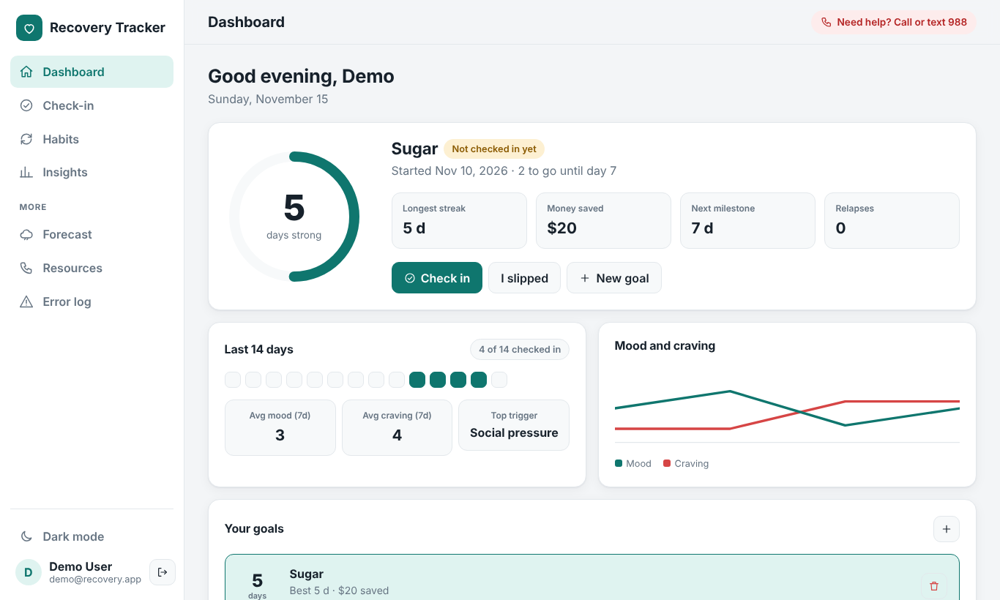
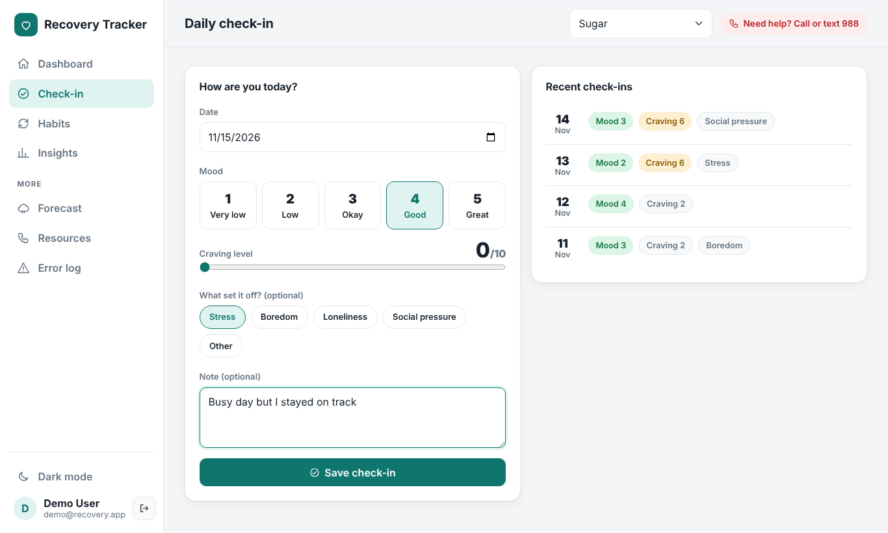
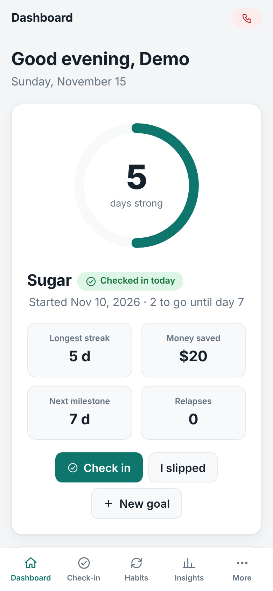

# Recovery Tracker

A web app for people working to stop an addiction or a habit. Create an account, set a goal, check in every day, build replacement habits and see which days are hardest before they arrive.



## What it does

- **Accounts.** Register and sign in. Every goal, check-in and habit belongs to one account and no other account can see it.
- **Dashboard.** Current streak in a progress ring, longest streak, milestones (1, 3, 7, 14, 30, 60, 90, 180 and 365 days), money saved, a 14 day check-in strip and a mood and craving trend.
- **Daily check-in.** Mood from 1 to 5, craving from 0 to 10, an optional trigger and an optional note. One check-in per goal per day.
- **Relapse logging.** A slip restarts the streak at day 1 and keeps the longest streak.
- **Replacement habits.** Five defaults for every new goal, plus your own. Press "I did this instead" to count a win.
- **Insights.** 14 day consistency, which triggers come with the strongest cravings, and your peak craving.
- **Risk forecast.** Rates each of the next 7 days as low, medium or high from your own check-in history, and suggests the habit that has worked best for you.
- **Support resources.** Crisis lines and support groups. A "Call or text 988" button is always visible.
- **Error log.** Every error your account triggers is saved with a code, a message and the request, and can be resolved or cleared.
- **Works on a laptop or a phone.** Sidebar layout on a laptop, bottom tab bar on a phone, and a dark mode.

| Laptop | Phone |
|---|---|
|  |  |

## Run it on any laptop

You need one of the three setups below. Every setup serves the app at **http://localhost:3000**.

### Option 1: Docker (nothing else to install)

1. Install [Docker Desktop](https://www.docker.com/products/docker-desktop/) (Windows, macOS or Linux) and start it.
2. Download this project: `git clone https://github.com/jaminrunja-arch/recovery-tracker.git`
3. Open a terminal in the project folder (`cd recovery-tracker`).
4. Run `docker compose up --build`
5. Open http://localhost:3000 and choose **Create account**.

Your data stays in Docker volumes when you stop the app. Stop it with `Ctrl+C`. Start it again with `docker compose up`.

### Option 2: Node.js and MongoDB on your laptop

1. Install [Node.js](https://nodejs.org) version 18 or newer.
2. Install [MongoDB Community Edition](https://www.mongodb.com/try/download/community) and start it. It listens on port 27017 by default.
3. In the project folder run `npm install`
4. Run `npm start`
5. Open http://localhost:3000

### Option 3: Node.js and a free MongoDB Atlas database

1. Create a free cluster at [MongoDB Atlas](https://www.mongodb.com/atlas) and copy its connection string.
2. In the project folder run `npm install`
3. Set the connection string and start the app.
   - macOS and Linux: `MONGO_URL="your-connection-string" npm start`
   - Windows PowerShell: `$env:MONGO_URL="your-connection-string"; npm start`
4. Open http://localhost:3000

### Load sample data

`npm run demo` creates a sample account with three goals and a month of check-ins. Sign in with **demo@recovery.app** and password **demo1234**.

With Docker, run `docker compose exec app node scripts/seed-demo.js` instead.

## Settings

| Variable | Default | What it does |
|---|---|---|
| `PORT` | 3000 | Port the app listens on |
| `MONGO_URL` | `mongodb://127.0.0.1:27017/recovery_tracker` | Database connection string |
| `SESSION_SECRET` | created on first start and saved in `.session-secret` | Signs the sign-in tokens. Set it yourself if you run more than one copy of the app |
| `DATA_DIR` | the project folder | Where `.session-secret` is saved |
| `RATE_LIMIT_MAX` | 300 | Requests per minute per IP address |

## Tests

`npm test` runs 116 Jasmine specs for the streak, insight and forecast logic, the error registry, validation, the rate limiter, the write lock, the dashboard cache and the account code.

The `attacks/` folder has a script that attacks the running app on purpose: 100 users at once, a flood of 4000 bad requests, simultaneous duplicate writes, unlimited data growth, oversized bodies, operator injection, wrong types, path traversal, and access control (no token, forged tokens, another user's data, password guessing). Run it with `cd attacks && npm install && bash run.sh`. It needs `python3` and a running MongoDB. It starts its own copy of the server on port 3300 with a throwaway database.

## How it is built

- **Server:** Node.js, Express 4 and Mongoose 8
- **Browser:** AngularJS 1.8 and Bootstrap 5 (CSS only), plus a small stylesheet for the app layout
- **Database:** MongoDB
- **Tests:** Jasmine 5

```
server.js            starts the app, wires routes and the error handler
auth.js              password hashing (scrypt), signed tokens, sign-in check
routes/              auth, goals, checkins, habits, insights, forecast, errors, resources
models/              user, goal, checkin, habit, resource, errorlog
streak.js            streaks, milestones, money saved
insights.js          consistency, trigger breakdown, peak craving
forecast.js          7 day risk forecast
validate.js          id, number and text checks
limiter.js           per-IP rate limiter
lock.js              serializes simultaneous writes
cache.js             short-lived dashboard cache
headers.js           security headers and content security policy
errors/              error catalog, classification and registry
public/              the interface (index.html, app.js, styles.css)
scripts/seed-demo.js sample data
attacks/             attack scripts
spec/                Jasmine specs
```

### Safety measures

- Passwords are hashed with scrypt and a random salt. Sign-in tokens are signed with HMAC-SHA256 and expire after 7 days. Sign-in and registration are limited to 20 attempts per minute per IP address.
- Every route except the support resources requires a token, and every query is limited to the signed-in account.
- Every id must be a 24 character hex string, so query operators like `goalId[$ne]` are rejected. Numbers and text are checked for type and length.
- Request bodies are limited to 10 KB. Each account is limited to 25 goals, 30 habits per goal and 50 relapses per goal.
- A unique index plus a write lock stops duplicate check-ins and lost counter updates when requests arrive together.
- A content security policy only allows scripts from the app itself. Other headers refuse framing and content sniffing.
- If the database goes down, requests fail in under a second with a clear message and the app recovers by itself when the database returns.

## Known limits

- This is a class project. It is not medical advice and it is not a replacement for treatment or a counselor. In the US, call or text 988 in a crisis.
- The app serves plain HTTP. Put it behind an HTTPS reverse proxy before anyone uses it over the internet.
- There is no password reset or email check yet.
- The rate limiter and the dashboard cache live in the memory of one server process, so they would need to move to shared storage before running several copies.
- Development testing used a MongoDB-compatible database (FerretDB). The Docker setup uses the official MongoDB 7 image.
- The forecast learns from your own check-ins only. It needs at least 2 check-ins on a weekday before it rates that weekday.

## API

All routes except `/api/auth/register`, `/api/auth/login`, `/api/resources` and `/api/health` need the header `Authorization: Bearer <token>`.

| Method and path | What it does |
|---|---|
| POST `/api/auth/register` | Create an account and get a token |
| POST `/api/auth/login` | Sign in and get a token |
| GET `/api/auth/me` | The signed-in account |
| GET `/api/goals` | Your goals with streak summaries |
| POST `/api/goals` | Add a goal |
| POST `/api/goals/:id/relapse` | Log a relapse |
| DELETE `/api/goals/:id` | Delete a goal and its check-ins and habits |
| GET, POST `/api/checkins` | List the last 14 check-ins for a goal, add one |
| GET, POST `/api/habits` | List habits for a goal, add one |
| POST `/api/habits/:id/use` | Count a win |
| DELETE `/api/habits/:id` | Remove a habit |
| GET `/api/insights` | Consistency, triggers and peak craving for a goal |
| GET `/api/forecast` | 7 day risk forecast and plan for a goal |
| GET `/api/errors`, `/api/errors/summary`, `/api/errors/catalog` | Your error log |
| POST `/api/errors/:id/resolve`, DELETE `/api/errors/resolved` | Resolve or clear entries |
| GET `/api/resources` | Hotlines and support groups |
| GET `/api/health` | Server and database status |

Errors look like `{ "error": "Wrong email or password", "code": "E605" }`. The full list of 39 codes is at `/api/errors/catalog`.
